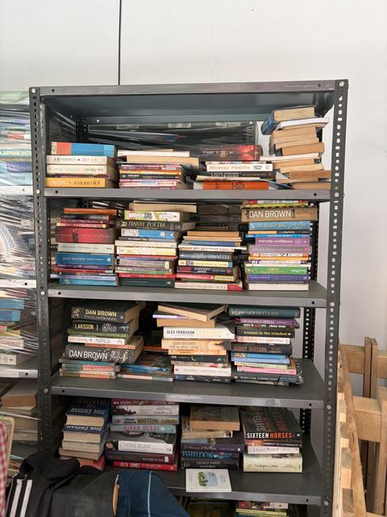

# Can an AI chat model read a bookshelf?

**Results page:** https://atharva-729.github.io/bookshelf-benchmark/ (source in [`docs/`](docs/))

We gave Claude, Gemini and ChatGPT the same six photos of real bookshelves and asked each one to list every book whose title it could read. Then we checked every answer against a hand-verified list of 295 books.

**The short answer:** they are careful, but not thorough. When a model names a book, it is almost always really there (84–98% of the time). But the best setup found only 82% of the books, and the weakest found under a third. Crowded shelves are where models differ most: Claude found far more books there, while Gemini 3.8 Flash did best on tidy shelves.

This README explains what the project is, how it flowed from start to finish, what was planned against what was actually done, and what we learned. The technical detail is in [`notes/`](notes/).



*Photo e, the hardest of the six: 108 books in the answer key.*

## The project in one minute

| | |
| --- | --- |
| **Question** | How well can multimodal AI models identify the books in a bookshelf photo? |
| **Data** | 6 real bookshelf photos (2 easy, 2 medium, 2 hard) with 295 books, each confirmed by a person |
| **Models** | 7 models from Anthropic, Google and OpenAI. Counting their thinking settings, 12 setups |
| **How they were used** | The normal chat apps (ChatGPT, Claude.ai, Gemini), not the APIs |
| **Task** | One fixed prompt: "list every book whose title you can read, and don't guess", answered as JSON |
| **Scoring** | **Recall**: of the books on the shelf, how many the model found. **Precision**: of the books the model named, how many were really there. **F1** combines the two. Titles are matched loosely, so small wording differences don't count as wrong |
| **Experiments** | 1: all six photos in one message, run twice. 2: the two hard photos sent one per chat |

### Headline results

Experiment 1, all six photos in one message. Run 2 numbers, best first, with run 1 F1 for comparison.

| Setup | Books found (recall) | Right when named (precision) | F1 run 2 | F1 run 1 | Est. API cost |
| --- | ---: | ---: | ---: | ---: | ---: |
| Claude Opus 5.5, high effort | 82% | 97% | 0.89 | 0.86 | $0.31 |
| Claude Opus 5.5, low effort | 81% | 94% | 0.87 | 0.72 | $0.17 |
| Claude Opus 5, high effort | 75% | 95% | 0.84 | 0.83 | $0.45 |
| Claude Sonnet 5.5, high effort | 70% | 96% | 0.81 | 0.80 | $0.13 |
| Claude Sonnet 5.5, low effort | 57% | 92% | 0.70 | 0.73 | $0.07 |
| Gemini 3.8 Flash, extended thinking | 54% | 98% | 0.69 | 0.70 | $0.09 |
| Claude Sonnet 5, high effort | 51% | 95% | 0.66 | 0.58 | $0.15 |
| Gemini 3.1 Pro, extended thinking | 51% | 92% | 0.65 | 0.61 | $0.07 |
| Gemini 3.1 Pro, standard | 50% | 90% | 0.64 | 0.60 | $0.05 |
| Gemini 3.8 Flash, standard | 48% | 89% | 0.62 | 0.69 | $0.02 |
| GPT 5.6 Luna, thinking | 44% | 92% | 0.59 | 0.45 | $0.03 |
| GPT 5.6 Luna, standard | 41% | 93% | 0.57 | 0.47 | $0.02 |

The chat apps show no token counts, so costs are estimates of what the same request would cost through the API. The results page has the per-photo breakdown, and every tile there opens the exact list of books found, missed and named wrongly.

## How the project flowed

The project went through eight stages. Each one fed the next, and two of them (6 and 7) were not in the original plan: they came from looking at the results.

```
 1. Idea             Photos of messy shelves. Can an AI list the books reliably?
       │
 2. Answer key       Claude Code splits each photo into sections and drafts a book list →
       │             a person checks every book → cut to 6 photos, 295 books → frozen
 3. Prompt           One fixed prompt for every model. JSON out. "Don't guess."
       │
 4. Run              12 model setups in the ChatGPT, Claude and Gemini apps.
       │             Every reply saved exactly as given.
 5. Score            Loose title matching → precision, recall, F1, per photo
       │
 6. Follow-up        Models did badly on the hard photos. Was it the six-photo message?
       │             → experiment 2: one photo per chat
 7. Repeat + price   All 12 setups run again by a browser-driving agent
       │             → how consistent are results? what would each run cost?
 8. Publish          Results page in docs/, this README, notes/
```

In words:

1. **Idea.** Trying to get an AI to name the books in photos of chaotic bookshop displays gave mixed results: misread spines, missed books, and books that weren't there. My manager turned that into a measurable question: on photos where the real books are known, how well do different models, and different ways of using them, identify the books?
2. **Answer key.** You can't score a model without knowing the right answer, so the first job was a list of every readable book in each photo. This was the slowest step (details below).
3. **Prompt.** One prompt, written once and then frozen, so every model got the same task. It asks for JSON so the answers can be scored automatically.
4. **Run.** Each of the 12 setups got the six photos and the prompt in a fresh chat. The reply was pasted, unedited, into a file in `results/`.
5. **Score.** A Python script compares each reply with the answer key, book by book, and computes the scores. Every match and non-match is saved so it can be checked by hand.
6. **Follow-up: experiment 2.** The first results showed models naming too few books on the crowded photos. To test whether sending six photos at once was the cause, the two hard photos were sent again, one per chat.
7. **Repeat and price.** To estimate cost, timing data was needed, and the first chats hadn't kept it. So all 12 setups were run a second time, this time by a coding agent driving the browser, which recorded timings. The rerun also showed how much results vary between identical runs.
8. **Publish.** The results page, built from the scored data, plus these write-ups.

## What was planned, and what was actually done

The original plan ([PROJECT_BRIEF.md](PROJECT_BRIEF.md)) had three layers: a first benchmark, a model-vs-harness experiment, and a set of "does the packaging of the input matter?" experiments. The first layer is done and went further than planned. The second was not possible without API access. Most of the third is still open.

| Planned | What happened |
| --- | --- |
| Freeze a 6-photo answer key | **Done.** Started with 11 photos, cut to 6 (see below). |
| Run 2–3 accessible models with one standard prompt | **Done, and more:** 7 models, 12 setups. |
| Prefer APIs, for control | **Changed.** No API access, so all runs used the consumer chat apps. This is closer to how people use the tools, but the apps can resize images, add hidden instructions and run tools without saying so. |
| Save raw outputs; record how each model was accessed | **Done.** Every reply is in `results/*/replies/`, with model, mode, app and date. |
| Evaluator with fuzzy matching; precision, recall, F1, per image | **Done.** `benchmark/evaluate.py`. |
| Per-image results table, failure examples | **Done.** On the results page. |
| Static results page on GitHub Pages | **Done** (`docs/`). |
| Direct prompting vs a lightweight verification harness | **Not done.** It needs API access to crop and re-ask. An observation is recorded instead (see "Model vs harness" below). |
| All photos in one prompt vs one photo per prompt | **Done** as experiment 2, on the two hard photos. Not originally a first-stage task; it came from the results. |
| Repeated trials for consistency | **Partly.** Experiment 1 was run twice. More runs are needed for error bars. |
| Cost per run | **Done, as an estimate.** The apps show no tokens, so cost was rebuilt from timings and published pricing rules. |
| ZIP of all images vs separate images | Not done. |
| Image compression (original vs compressed) | Not done. |
| Other formats: PDF, DOCX, Markdown, plain text, base64 | Not done here. A separate project, [base64-image-probe](https://github.com/atharva-729/base64-image-probe), looked at reading images from base64 text. |

## What happened, step by step

### 1. Building the answer key

Every model is scored against the answer key, so it had to be right. It was made in three steps:

1. **Split the photos.** Claude Opus 5.5 at medium effort, running in Claude Code, cut each photo into small sections of the full-resolution image (over a hundred in all) and read the spines in each one.
2. **Draft the list.** From those sections it produced one list per photo: every book it could read, with the author where it could.
3. **Check every book by hand.** A person went through the whole list, book by book, and checked each one against the photo: there, or not there. Only the books confirmed this way went into the key.

This started with 11 photos. Five of them still had many readable books left to check. Finishing them would have meant checking hundreds more books, and leaving them incomplete would have counted correct model answers as mistakes. So they were dropped, leaving **6 photos and 295 books**. The answer key was then frozen: a model naming a book never adds it to the key. The dropped photos are kept in [`archive/`](archive/).

This step also produced the biggest lesson of the project (see step 6): the same model, used differently, read the shelves far better than it did in a chat.

### 2. Choosing the setups

Every model that was accessible got a run: Claude Opus 5.5 and Sonnet 5.5 at low and high effort, the older Opus 5 and Sonnet 5 at high effort (so any gap to the newer ones comes from the model, not the setting), Gemini 3.1 Pro and 3.8 Flash in standard and extended-thinking modes, and GPT 5.6 Luna in standard and thinking modes. Medium effort was skipped because low against high gives the clearest signal.

### 3. Run 1, and a surprise in the scoring

Each setup got all six photos in one message with [the standard prompt](benchmark/prompts/all_photos.md). When the Claude replies were first scored, they looked terrible. They weren't: every list was right, but under the wrong letter. Claude's list for "a" was really photo d. The Claude app doesn't show the model the filenames, so it lettered the photos in its own order. The scorer was changed to find the best letter-to-photo assignment and correct it before scoring. Only whole lists move, so a single book listed under the wrong photo still counts against the model.

The scorer also had to learn to forgive wording: "Attack on Titan Omnibus" is the same book as "Attack on Titan: Omnibus (Volumes 1-2-3)", and "Modern Judgements: Racine" is "Racine: Modern Judgements". The rules are in [notes/metrics.md](notes/metrics.md).

**What run 1 showed:** precision was high almost everywhere, so models rarely invented books. Recall was what separated them. On the crowded photo e (108 books), Claude setups found 44–77% of the books, GPT 31–37% and Gemini only 16–20%. On the two tidy photos it flipped: Gemini 3.8 Flash scored best of all.

### 4. Experiment 2: one photo per chat

The weak results on the hard photos raised a question: was the model rationing its answer across six photos? So the two hard photos were sent again, each in its own chat, with [the same rules](benchmark/prompts/one_photo.md).

For Claude, yes. Every Claude setup found at least as many books alone. Opus 5.5 at low effort jumped from 47% to 78% recall on the hard photos, the same as Opus 5.5 at high effort. That changed how run 1 reads: most of the gap between low and high effort came from the six-photo message, not the effort setting. For Gemini, no: recall barely moved (20% → 22%); it just named fewer wrong books.

Three setups were dropped from this experiment because they kept failing in their apps: Gemini 3.8 Flash with extended thinking and both GPT setups.

### 5. Run 2: repeating everything, and pricing it

To estimate cost, timing data was needed, and the first chats hadn't kept it. So on 4 October all 12 setups were run again. This time a coding agent did the clicking: Claude Code, driving the chat apps in the Brave browser through the Claude in Chrome extension. It opened private chats, picked the model and setting, attached the photos, pasted the prompt and saved the reply exactly as given. It also read each app's own conversation data, which confirmed which model actually answered and when it started and stopped thinking.

What the rerun showed:
- **Results vary a lot between identical runs.** Claude Opus 5.5 at low effort went from F1 0.72 to 0.87, and GPT 5.6 Luna in thinking mode from 0.45 to 0.59. Most other setups moved by less than 0.10.
- **ChatGPT ran Python text recognition on the photos, even in standard mode**, and its Think mode was served by a different model (`gpt-5-6-t-mini`). Think mode took 17 minutes.
- **Extra thinking pays off unevenly.** It added only 0.01–0.02 F1 for Opus 5.5, Gemini 3.1 Pro and GPT, but 0.08–0.10 for Sonnet 5.5 and Gemini 3.8 Flash.

Cost was estimated as the API price of the same request: the photos at each provider's image-token rule, the reply, and thinking time multiplied by the speed the run wrote its reply. Details are in [notes/experiments.md](notes/experiments.md#how-cost-is-estimated).

### 6. Model vs harness: the biggest lesson

The answer key was drafted by Claude Opus 5.5 at **medium** effort in Claude Code, working through small sections of each photo, and its list covered nearly every readable book. In the Claude.ai chat at **high** effort, the same model found about 77% of the books on the hardest photo, and less on others.

Same model, less effort, much better result. What changed was the harness around it: full-resolution sections instead of a whole photo the chat app shrinks, over a hundred passes instead of one look at six photos, and a coding tool that could cut the images up. So the way a model is run can matter as much as which model it is. This was not measured as a proper experiment, because the planned verification harness needs API access, but it is the clearest thing the project showed.

## What we learned

1. **The harness matters, not just the model.** Claude Opus 5.5 at medium effort in Claude Code, reading the photos section by section, did far better than the same model at high effort in the Claude.ai chat.
2. **Models are careful, not thorough.** What they name is usually right. What they miss is the real difference between them.
3. **The best model depends on the shelf.** Claude reads crowded shelves far better; Gemini 3.8 Flash is best on tidy ones, and the cheapest.
4. **Sending several photos at once can hold a model back.** Claude found many more books with one photo per chat. Gemini did not.
5. **One run is not enough.** Identical runs a few days apart differed by up to 0.15 F1.

## Read with care

- **Two runs at most**, so small gaps between setups may be noise.
- **Chat apps, not APIs.** A result means "model X in app Y on that date". The apps may resize photos, add hidden instructions or run tools.
- **"Not in the answer key" is not always wrong.** Some real books were left out of the key as too hard to confirm (for example *The Secret Life of Bees*, named in 6 replies), so precision is slightly understated for everyone.
- **Loose matching can slip.** It can pair two similar titles, and a Hindi title written in Latin letters does not match the same title in Devanagari.
- **Six photos.** Enough to see patterns, not to rank models in general.

## Repository

```
data/              the 6 photos (images/) and the frozen answer key (ground_truth.json)
benchmark/         prompts/ and the scripts: scoring, cost estimate, page data
results/
  exp1-run1/       experiment 1, first run: raw replies, scores, book-by-book details
  exp1-run2/       experiment 1, repeat run: the same, plus timing data and cost
  exp2-one-photo/  experiment 2: raw replies, scores, details
docs/              the results page (GitHub Pages)
notes/             experiments.md (lab notebook), metrics.md (scoring rules), reference.md (file formats)
archive/           early material the benchmark doesn't use
PROJECT_BRIEF.md   the original project brief and to-do list
```

### Re-running the scoring

Needs Python 3 only, with nothing to install.

```
python benchmark/evaluate.py         # score experiment 1, both runs
python benchmark/evaluate_single.py  # score experiment 2
python benchmark/estimate_cost.py    # cost estimates for run 2
python benchmark/build_site.py       # refresh docs/data.js for the results page
```

To run the experiments again yourself, follow [notes/experiments.md](notes/experiments.md). File formats and how to add a new run are in [notes/reference.md](notes/reference.md).
